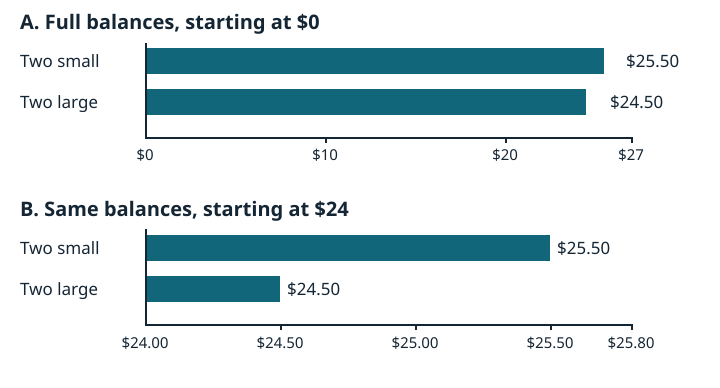

# 5. Audit the chart baseline

*Before interpreting two bars, check what their lengths represent.*

The household compares what remains after two small packages versus two large packages. The amounts are $25.50 and $24.50. The difference is $1.00 because the charges differ by $1.00. Both values refer to the same starting ledger, after the bill and before optional spending. The purpose of the graph is to report these two totals, not to suggest that buying small packages has a general causal effect on savings.

| Basket | Account balance | Distance above $24.00 |
| --- | ---: | ---: |
| Two small | $25.50 | $1.50 |
| Two large | $24.50 | $0.50 |

With a zero baseline, bar lengths in dollars can represent account totals. Starting at $24 makes one bar appear three times as long as the other. The numbers three and one can both occur here without contradiction: 1.50/0.50 is 3, while 25.50/24.50 is just over 1.04. The cropped bars measure amounts **above $24**, not the full balances. If that is what you intend to measure, name it as a different quantity. Otherwise use the zero baseline for total-value bars, or report the exact difference in a table.

## Compare a pattern, not only a picture

Below are model balances at two amounts of optional spending. Each extra $2.00 lowers either balance by $2.00. The difference between the two baskets stays $1.00 as long as we change both by the same amount.

| Optional spend | After two small | After two large |
| ---: | ---: | ---: |
| $0.00 | $25.50 | $24.50 |
| $2.00 | $23.50 | $22.50 |
| $4.00 | $21.50 | $20.50 |

This is an arithmetic relationship inside the assumed ledger, not an observed trend for other households. Read chart titles, units, baseline, and labels, then state the comparison in a sentence another reader can recompute.

Work the [household puzzle](../practice/household-puzzle.md) before reading the [answer key](../practice/answer-key.md). A different transfer case checks whether you can use the same method without the original numbers.
